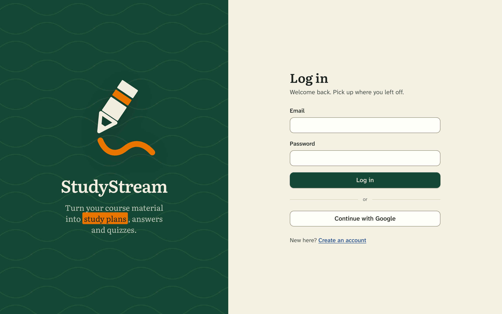
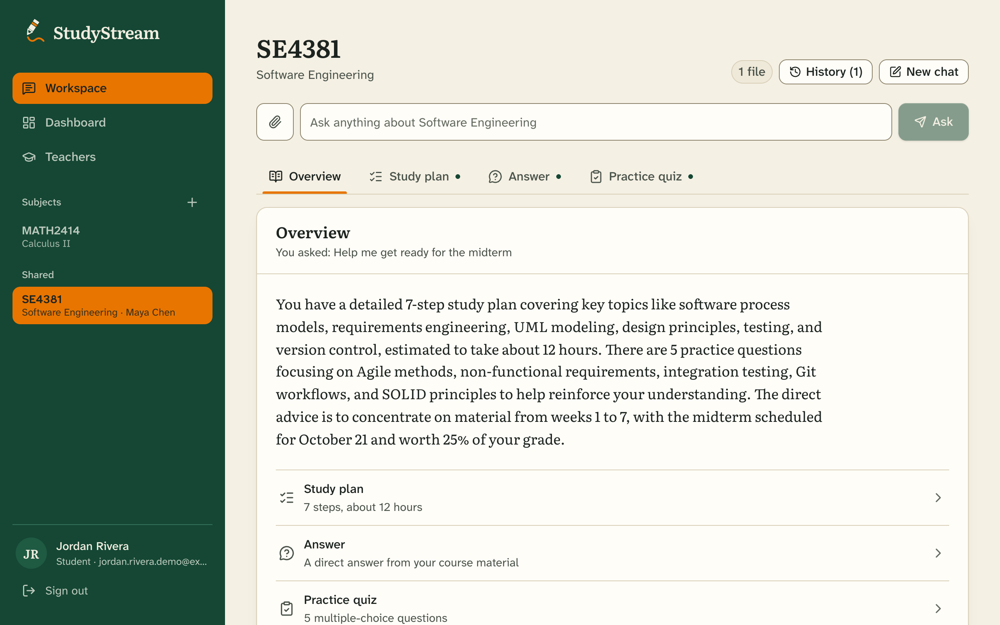
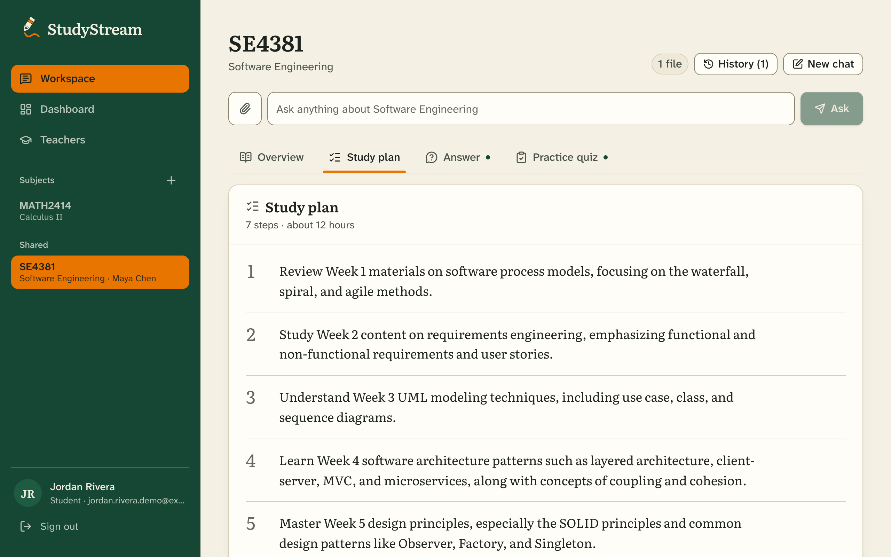
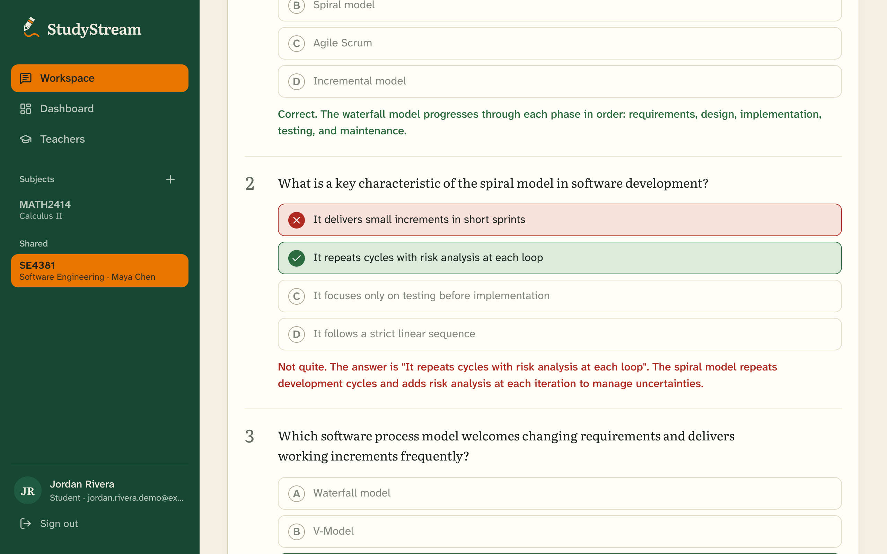
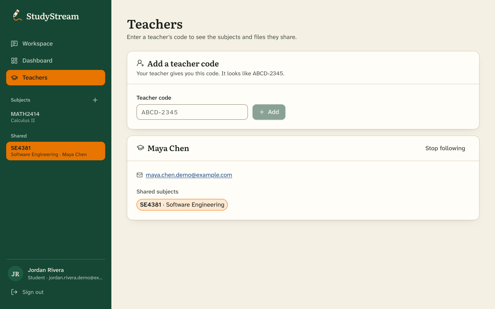

# StudyStream

StudyStream is a study helper for college classes. You upload your own course material (a syllabus, lecture notes, a reading) and ask it a question in normal words. It answers from your files instead of making things up, and if your files don't cover the question it says so.

It started as a class project at UT Dallas, and the idea was pretty simple: studying from a syllabus and 40 pages of slides is a lot easier when something can pull out the parts that matter and quiz you on them.



## What it does

You ask one question and it goes to 3 small agents, each with its own job:

| Agent | What you get |
| --- | --- |
| **Study Planning** | A step-by-step plan, the topics to focus on, and about how long it should take |
| **Assessment** | A practice quiz written from your material, with feedback under every question (green if you got it right, red if not) |
| **FAQ** | Plain answers about the course, like grading, deadlines, and summaries of a reading in simple words |

An overview tab sums up all three, and every answer lists the files it came from.







Other stuff in the app:

- Chat history, so you can go back to an old question and its full answer
- A Dashboard with questions asked, quizzes finished, and your average score per subject
- Upcoming Assignments on the Dashboard (add, edit, check off, delete). It's your own list, private to you
- Upload `.txt`, `.pdf` or `.docx` files, with an editable description for each one
- Works on a phone, where the sidebar turns into a drawer

## Teachers, TAs and students

Anyone can sign up as a student. Teachers and TAs need an invite code (set by whoever runs the app).

| | Student | TA | Teacher |
|---|---|---|---|
| Sign up | Anyone | Invite code | Invite code |
| Ask questions, quizzes, study plans, assignments | Yes | Yes | Yes |
| Upload files | Private to them | Shared with the class | Shared with the class |
| Edit or delete class files | No | Yes | Yes |
| Create a subject | Private only | Private only | Private or **Public** |
| Enter a teacher code | Yes | Yes | No |
| Own teacher code to hand out | No | No | Yes (**Your class** page) |
| Class totals on the Dashboard | No | No | Yes |

How the sharing works: a teacher makes a subject **Public** with the switch when creating it, then gives students their code from the **Your class** page. A student (or TA) enters it under **Teachers** and sees the teacher's name, email and shared subjects. Those subjects show up under **Shared** in their sidebar. Teachers can also see the names and emails of everyone linked to them. Unlinking takes the subjects away again.



## How it fits together

```text
Browser (React + TypeScript, :5173)
        |  POST /ask   Authorization: Bearer <supabase jwt>
        v
Orchestrator (FastAPI, :8001)      <- the only service the browser talks to
        |  picks the agents that can help, calls them in parallel
        +---------------+---------------+
        v               v               v
   FAQ (:8000)   Assessment (:8002)  Study (:8003)
        |               |               |
        +---------------+---------------+
                        v
        Supabase (pgvector) + Azure OpenAI
```

The orchestrator checks the Supabase login token once and the agents are only called by the orchestrator. The agents fail on their own, so if a course has no material the study and FAQ tabs say that and the quiz tab doesn't break the others.

For the answers, uploaded files get split into chunks and embedded (batches of 16, which cut the number of Azure calls a lot), and each agent looks up the closest chunks before writing anything. Exact request and response shapes are in [`orchestrator-work/API_CONTRACT.md`](orchestrator-work/API_CONTRACT.md).

## Folders

```text
Study-Feedback-Agent/
├── start.sh                     starts everything
├── DATABASE_SETUP.md            create your own Supabase project
├── DATABASE_MIGRATION.sql       the extra tables (run once)
├── DESIGN.md                    colors, fonts, the highlighter thing
├── classroom-assistant-ui/      React frontend, port 5173
│   └── src/ (components, lib, pages)
└── orchestrator-work/           backend
    ├── orchestrator/            port 8001 (routing, auth, store.py)
    ├── faq-agent/               port 8000
    ├── assessment-agent/        port 8002
    ├── study-agent/             port 8003, also handles uploads
    ├── shared/                  common.py (clients, chunking, retrieval)
    └── test/
```

## Setup

You need Python 3.10+, Node 20+, and an Azure OpenAI deployment plus a Supabase project.

**1. Python environment** (from the project root)

```bash
python3 -m venv .venv-1
source .venv-1/bin/activate
pip install -r orchestrator-work/shared/requirements.txt
```

**2. Frontend packages**

```bash
cd classroom-assistant-ui && npm install && cd ..
```

**3. Backend `.env`**

```bash
cp .env.example .env
# fill in the Azure and Supabase values
cp .env orchestrator-work/.env
```

Use the Supabase **service_role** key here, not the anon key. Also set `TEACHER_INVITE_CODE`. If you leave it empty nobody can sign up as a teacher or TA.

**4. Frontend `.env`** in `classroom-assistant-ui/`

```text
VITE_SUPABASE_URL=https://your-project.supabase.co
VITE_SUPABASE_ANON_KEY=your_anon_key
VITE_API_BASE_URL=http://127.0.0.1:8001
```

This one uses the **anon** key since it runs in the browser. Neither `.env` is committed, so don't add them.

**5. Database**

Follow [`DATABASE_SETUP.md`](DATABASE_SETUP.md) first (about 10 minutes, one copy-paste block). Then run [`DATABASE_MIGRATION.sql`](DATABASE_MIGRATION.sql) once in the Supabase SQL editor. It adds subjects, chat history, assignments and the teacher code tables, and it's safe to run again. Until it's run the app still starts, but the pages that need those tables show a message telling you to run it.

**6. Supabase auth**

Turn **off** email confirmation while developing (Authentication -> Providers -> Email). With it on, signup gives back a user but no session, so the profile step has no token and sign up fails.

## Running it

```bash
./start.sh
```

That starts the 4 backend services and the frontend. Open <http://localhost:5173> (API docs are at <http://127.0.0.1:8001/docs>). Ctrl+C stops everything.

Backend only is `./orchestrator-work/start.sh`, frontend only is `cd classroom-assistant-ui && npm run dev`.

## Tests

The unit tests don't need Azure or Supabase since they use a fake in-memory database (106 checks for courses, chat history, assignments, teacher codes and the role rules):

```bash
./.venv-1/bin/python orchestrator-work/test/test_units.py
```

There's also `orchestrator-work/test/test_orchestrator.py`, which hits the running backend with real Azure calls (set `REQUIRE_AUTH=false` first). It takes about 90 seconds.

## If something breaks

- **"Could not reach the server"**: the backend isn't running. Use `./start.sh` from the root.
- **`Address already in use`**: an old run is holding the ports. `pkill -f "uvicorn main:app"` and start again.
- **`api_key must be set`**: `orchestrator-work/.env` is missing, so `cp .env orchestrator-work/.env`.
- **Everything is 401**: set `REQUIRE_AUTH=false` in `orchestrator-work/.env` for local work.
- **"No course material found"**: that subject has no files yet. Upload one.
- **Signup fails after the account is made**: email confirmation is still on (step 6).
- **A page says to run the migration**: run `DATABASE_MIGRATION.sql`.

## Not done yet

- No rate limit, so someone could keep guessing teacher codes
- Scanned PDFs get rejected as empty since there's no OCR
- Teachers only see class totals, not individual student scores (on purpose, for now)
- Google sign-in hasn't been tested

## Design

The look is a study hall: a chalkboard-green sidebar (UTD green), warm paper, and an orange highlighter for whatever is selected. [`DESIGN.md`](DESIGN.md) has the colors, fonts and rules so a new page matches the rest.
